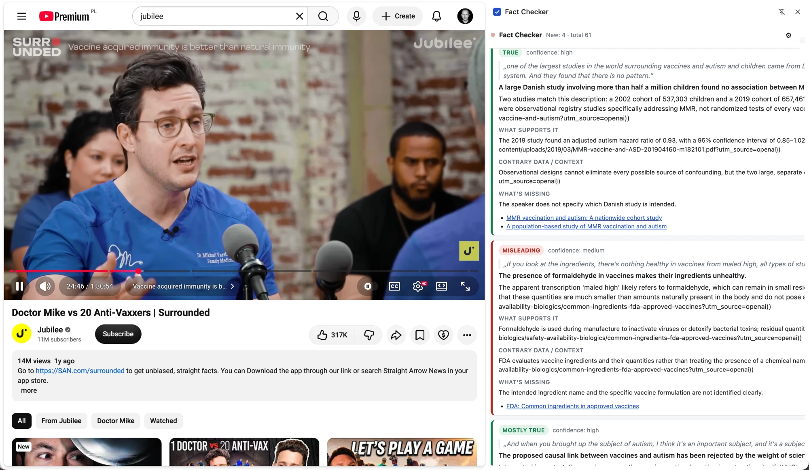
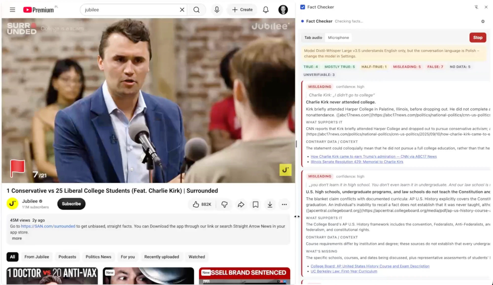
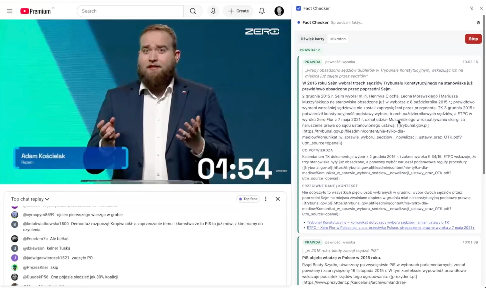
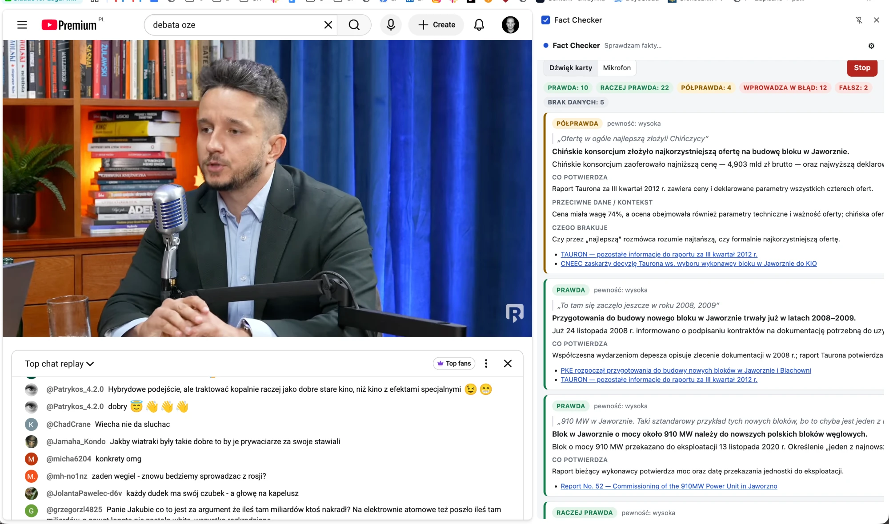

# Fact Checker — live fact-checking in Chrome, Edge and Opera

**[English](#english) · [Polski](#polski)**

### Install in 1 minute

1. Download the package for your browser (latest release):
   **[Chrome](https://github.com/dawidadach/fact-checker/releases/latest/download/fact-checker-chrome.zip)** ·
   **[Edge](https://github.com/dawidadach/fact-checker/releases/latest/download/fact-checker-edge.zip)** ·
   **[Opera](https://github.com/dawidadach/fact-checker/releases/latest/download/fact-checker-opera.zip)** — and unzip it.
2. Open **`chrome://extensions`** / **`edge://extensions`** / **`opera://extensions`** and switch on **Developer mode**.
3. Click **Load unpacked** and pick the unzipped folder (the one with `manifest.json`).
4. Click the extension icon → ⚙ → choose who checks the facts (ChatGPT plan, OpenAI, Gemini, Claude or OpenRouter) → **Start**,
   or point at an article, post or meme with the 📄 / 👆 / ✂ / 🔲 buttons.

### Instalacja w minutę

1. Pobierz paczkę dla swojej przeglądarki (najnowsze wydanie):
   **[Chrome](https://github.com/dawidadach/fact-checker/releases/latest/download/fact-checker-chrome.zip)** ·
   **[Edge](https://github.com/dawidadach/fact-checker/releases/latest/download/fact-checker-edge.zip)** ·
   **[Opera](https://github.com/dawidadach/fact-checker/releases/latest/download/fact-checker-opera.zip)** — i rozpakuj.
2. Wejdź na **`chrome://extensions`** / **`edge://extensions`** / **`opera://extensions`** i włącz **Tryb dewelopera**.
3. Kliknij **Załaduj rozpakowane** i wskaż rozpakowany folder (ten z plikiem `manifest.json`).
4. Kliknij ikonę wtyczki → ⚙ → wybierz, kto sprawdza fakty (plan ChatGPT, OpenAI, Gemini, Claude albo OpenRouter) → **Start**,
   albo wskaż artykuł, post lub mem przyciskami 📄 / 👆 / ✂ / 🔲.

Full guide in Polish: **[INSTRUKCJA.md](INSTRUKCJA.md)** · What's new: **[CHANGELOG.md](CHANGELOG.md)** ·
Privacy: **[PRIVACY.md](PRIVACY.md)**



---

## English

A browser extension (Chrome, Edge, Opera) that fact-checks what you watch and read, in a side panel:

- **Conversations** playing in a tab — interview, debate, podcast, live stream — checked as they happen, every ~30 seconds.
- **Text on web pages** — an article, a Facebook or X post, or a selected fragment — but only what you point at.
- **Memes, infographics, charts and photos** — the text in the image and the way it is presented.

For every claim that can be checked (numbers and statistics, references to studies, events, quotes, laws, historical facts)
it shows a verdict:

**True · Mostly true · Half-true · Misleading · False · No data · Unverifiable · Satire**

Each card shows the exact quote and who said it, the claim being checked, a short explanation, what supports it,
**contradicting data or context**, **what is missing** to settle it, and links to sources.



### Features

**Live conversations**
- Tab audio or microphone; speech is turned into text by a **local model on your computer** (free, offline) or by OpenAI.
- **Speaking now:** while recording you can mark who is speaking; verdicts and the report are attributed to that person.
- **Date of the statement:** taken from the video's metadata (e.g. YouTube) or set by hand. An old interview is judged by the
  facts of that time (“inflation is 18%” was true in February 2023).

**Text and images on web pages** (nothing is read until you point at it)
- 📄 **Article** – the article text only (Mozilla Readability), without menus and comments.
- 👆 **Pick a post** – one Facebook / X post without comments; Shift+click to pick several. Images in the post are included.
- ✂ **Selection**, or right-click → Fact Checker, or **Alt+Shift+F**.
- 🔲 **Screen area** – drag a rectangle (e.g. a chart in a video).
- A preview before sending; verdicts are **highlighted on the page** in the verdict's colour.
- Images: the model reads the text, checks fake quotes, misleading charts (truncated axes, cherry-picked ranges), screenshots
  of posts and satire. Reverse image search buttons (Google Lens, TinEye, Yandex) for photos taken out of context.

**Better verdicts**
- The model is told to prefer **primary sources** (e.g. for Poland: Sejm votes and transcripts, ISAP, GUS, NBP, Eurostat).
- **Existing fact-checks** (optional, free Google key): articles by fact-checking outlets from the Google Fact Check database are
  shown on the card, with a ⚠ warning when an outlet rated the claim differently.
- **Verdict memory:** the same text or image (e.g. a meme that keeps circulating) gets its earlier result instantly, at no cost.
  Every image is recognised on its own — a meme checked inside a post is recognised later on its own or in another post — while
  the same meme template with a different caption is not.

**Working with the results**
- **📋 Copy as reply** – a comment to paste under the post, written in plain language and matched to the post:
  *Matter-of-fact*, *Casual*, *Short for X* (fits 280 characters) or the *Original* verdict text. Sources are added as plain links.
- **Reply to the whole post** – one comment covering all verdicts of a post.
- **👍 / 👎 ratings** with a comment; export all ratings as JSON to improve the prompts.
- **Report** – a session (e.g. a debate) as a document: verdict breakdown, speakers table, all verdicts with sources;
  print / save as PDF or download as HTML.
- Filter **Only problems**, verdict counts per source, Markdown export.

**Sessions and history**
- Everything you check goes into the current session, grouped by source; sessions are saved automatically.
- 🕘 History with search, reopening, export and deleting.
- A **queue**: point at more posts while one is being checked.

**Costs and privacy**
- **Cost counter** for the session and the day, an optional **daily spending limit**, and three modes:
  *Economy* / *Normal* / *Thorough*.
- **Hide people:** blur profile pictures and author names on screenshots and do not send the post author.
- API keys can be kept only until the browser closes. No analytics, no server of our own — see [PRIVACY.md](PRIVACY.md).

### Who checks the facts

| Provider | What you need | Web search | Images |
|---|---|---|---|
| **ChatGPT plan** | Sign in with your ChatGPT Plus/Pro account | depends on model and account | yes |
| **OpenAI** | API key (pay per use) | yes | yes |
| **Google Gemini** | API key – has a free tier | yes (Google Search; free monthly quota) | yes |
| **Anthropic Claude** | API key (pay per use) | yes (enable it in the Anthropic console) | yes |
| **OpenRouter** | one key, many models (Claude, Gemini, GPT, free models) | yes | depends on the model |

Anthropic does not allow Claude Free/Pro/Max logins in third-party apps, so Claude works only with an API key.
With the ChatGPT plan the extension costs nothing extra: transcription runs locally and fact-checking uses your plan
(OpenAI's program is in preview; usage counts toward your plan limits, see
[ChatGPT → Settings → Usage](https://chatgpt.com/settings/usage)).

### Local speech models

Download a model once in ⚙ Settings → **Local models**. After that it works offline and nothing leaves your computer.

| Language | Tier | Model | Download (GPU / CPU) | Test result* |
|---|---|---|---|---|
| Polish | Best | Whisper Large v3 Turbo | 1.6 GB / 1.1 GB | 21.6% word error rate; needs a GPU for live use |
| Polish | Medium | Whisper Small | 410 MB / 249 MB | 52.7% WER, ~1.5 s per 1 s of audio on CPU |
| Polish | Light | Whisper Base | 165 MB / 77 MB | weak for Polish |
| English | Best | Distil-Whisper Large v3.5 | 1.6 GB / 1.0 GB | 0% WER; needs a GPU for live use |
| English | Medium | Whisper Small.en | 410 MB / 249 MB | 0% WER |
| English | Light | Moonshine Base | 113 MB / 63 MB | 0% WER, 1.4 s for 11 s of audio |

<sub>* Tested in Chromium without a GPU (CPU builds, q8 quantization). Polish: 45 s of read sentences with very quiet audio (FLEURS);
English: an 11-second speech clip. On a GPU the models run faster and at higher precision (fp16).</sub>

With a GPU pick **Best**; without one, **Medium**. Whisper Large v3 Turbo also understands English, so one model covers both
languages. The extension cuts audio at pauses, boosts quiet speech and filters typical Whisper hallucinations.

### Installation

Download the package for your browser from the **[latest release](https://github.com/dawidadach/fact-checker/releases/latest)**
and unzip it.

| | Chrome | Edge | Opera |
|---|---|---|---|
| Package | `fact-checker-chrome.zip` | `fact-checker-edge.zip` | `fact-checker-opera.zip` |
| Extensions page | `chrome://extensions` | `edge://extensions` | `opera://extensions` |
| Developer mode | top right | left panel, bottom | top right |
| Panel | Chrome side panel | Edge side panel | Opera sidebar, or a small window next to the browser |
| Built-in speech recognition | yes (microphone) | yes (microphone) | no – use a local model or OpenAI |

Then **Load unpacked** → the unzipped folder, and pin the icon (puzzle icon → pin / eye). Requires a Chromium-based browser
version 116 or newer. The repository root is the Chrome version, so a `git clone` can also be loaded directly in Chrome or Edge.

**Updating without losing settings:** replace the files in the same folder and click **↻ Reload** on the extension.
Do **not** click **Remove** — that deletes the extension's data (sign-in, keys, models, history). The extension has a fixed ID
(`key` in `manifest.json`), so everything survives updates.

### Usage

1. **A conversation:** open the tab with the video or podcast, click the Fact Checker icon **while on that tab**, choose
   **Tab audio** or **Microphone** and press **Start**. Verdict cards appear at the top, newest first.
2. **Text or images on a page:** use 📄 Article, 👆 Pick a post, ✂ Selection or 🔲 Screen area in the panel, or right-click →
   Fact Checker. Longer texts and all images show a preview first.
3. In ⚙ **Settings** choose the provider and model, the checking mode, the daily limit, the speech model and the languages.

The interface is in English or Polish (from the browser language, changeable in Settings). Verdicts are written in the
interface language; quotes stay in the original language.

### Privacy

- Audio is processed locally with a local speech model; only text goes to the model provider you chose.
- Page text and images are sent only after you point at them, and you see a preview first.
- Keys and sign-in tokens stay in this browser. Details: [PRIVACY.md](PRIVACY.md).

### Project structure

```
manifest.json          Chrome/Edge manifest (the Opera manifest is generated by scripts/build.mjs)
background.js          service worker: panel, context menu, shortcut, screenshots of images, ChatGPT sign-in callback
sidepanel.*            the side panel UI: live checking loop, page checks, queue, cards, settings
content/page.*         page script (injected only on user action): article / post / selection / area, highlighting
report.*, privacy.*    session report page, privacy policy page
lib/auth.js            Sign in with ChatGPT (PKCE, dynamic client registration, token refresh)
lib/llm.js             OpenAI Responses API (streaming, timeouts)
lib/providers.js       Gemini, Claude and OpenRouter adapters (same request format as OpenAI)
lib/factcheck.js       prompts, JSON schema of verdicts, parsing, duplicate detection
lib/capture.js         running the page script in a tab
lib/shot.js            screenshots of the visible images / screen area
lib/history.js         sessions (IndexedDB), Markdown export, ratings export
lib/memory.js          verdict memory: text hashes and image fingerprints
lib/factcheckapi.js    Google Fact Check Tools (existing fact-checks)
lib/pricing.js         price lists, cost counter, checking modes
lib/reply.js           “Copy as reply”: prompts, tones, plain-text sources
lib/report.js          session report (HTML)
lib/transcribe.js      tab/mic capture, cutting at pauses, local / OpenAI / browser transcription
lib/models.js          local speech models
lib/i18n.js            interface translations (English, Polish)
lib/vendor/            Mozilla Readability (Apache 2.0)
vendor/                transformers.js and ONNX Runtime Web (bundled: extensions may not load code from a CDN)
scripts/build.mjs      builds dist/fact-checker-{chrome,edge,opera}(.zip)
tests/                 unit tests
```

### Building and tests

```bash
npm test         # unit tests (node --test)
npm run build    # dist/fact-checker-chrome.zip, dist/fact-checker-edge.zip, dist/fact-checker-opera.zip
```

### Status

The original live-audio features were used on real YouTube debates in Polish and English (see the screenshots).
Page text, images and replies were used on real Facebook posts with the ChatGPT plan. All features are covered by
unit tests and by end-to-end tests in Chromium with the model providers stubbed; Gemini, Claude and OpenRouter have so far been
tested only against stubbed servers. If something fails, right-click the panel → **Inspect** and check the Console, and open an
issue.

---

## Polski



Wtyczka do przeglądarki (Chrome, Edge, Opera), która w panelu bocznym sprawdza fakty w tym, co oglądasz i czytasz:

- **Rozmowy** odtwarzane w karcie – wywiad, debata, podcast, transmisja – na bieżąco, co ok. 30 sekund.
- **Tekst na stronach** – artykuł, post z Facebooka albo X, zaznaczony fragment – ale tylko to, co wskażesz.
- **Memy, infografiki, wykresy i zdjęcia** – tekst na obrazku i sposób przedstawienia.

Dla każdego twierdzenia, które da się sprawdzić (liczby i statystyki, powoływanie się na badania, wydarzenia, cytaty, przepisy,
fakty historyczne), pokazuje werdykt:

**Prawda · Raczej prawda · Półprawda · Wprowadza w błąd · Fałsz · Brak danych · Nieweryfikowalne · Satyra / żart**

Karta zawiera dosłowny cytat i to, kto go powiedział, sprawdzane twierdzenie, krótkie wyjaśnienie, co je potwierdza,
**przeciwne dane lub kontekst**, **czego brakuje** do rozstrzygnięcia i linki do źródeł.



### Funkcje

**Rozmowy na żywo**
- Dźwięk karty albo mikrofon; mowę zamienia na tekst **lokalny model na Twoim komputerze** (za darmo, bez internetu) albo OpenAI.
- **Teraz mówi:** w trakcie nagrywania wskazujesz, kto mówi – werdykty i raport przypisują wypowiedzi tej osobie.
- **Data wypowiedzi:** z metadanych filmu (np. YouTube) albo wpisana ręcznie. Stary wywiad jest oceniany według ówczesnych
  danych („inflacja wynosi 18%” było prawdą w lutym 2023).

**Tekst i obrazki ze stron** (nic nie jest czytane, dopóki tego nie wskażesz)
- 📄 **Artykuł** – sama treść artykułu (Mozilla Readability), bez menu i komentarzy.
- 👆 **Wskaż post** – jeden post z Facebooka / X, bez komentarzy; Shift+klik – kilka po kolei. Obrazki z posta idą razem z nim.
- ✂ **Zaznaczenie**, prawy przycisk → Fact Checker albo **Alt+Shift+F**.
- 🔲 **Wycinek** ekranu – zaznaczasz prostokąt (np. wykres w filmie).
- Podgląd przed wysłaniem; werdykty są **podświetlane na stronie** kolorem werdyktu.
- Obrazki: model odczytuje tekst, sprawdza fałszywe cytaty, zmanipulowane wykresy (obcięte osie, wybrane zakresy), zrzuty postów
  i satyrę. Przyciski wyszukiwania obrazem (Google Lens, TinEye, Yandex) – na zdjęcia wyrwane z kontekstu.

**Lepsze werdykty**
- Model ma preferować **źródła pierwotne** (np. głosowania i stenogramy Sejmu, ISAP, GUS, NBP, Eurostat).
- **Gotowe fact-checki** (opcjonalnie, darmowy klucz Google): artykuły redakcji fact-checkingowych z bazy Google Fact Check
  na karcie, z ostrzeżeniem ⚠, gdy redakcja oceniła coś inaczej.
- **Pamięć werdyktów:** ten sam tekst albo obrazek (np. mem, który krąży od tygodni) dostaje wcześniejszy wynik od razu, bez
  kosztów. Każdy obrazek jest rozpoznawany osobno – mem sprawdzony w poście rozpozna się potem sam albo w innym poście – a ten
  sam szablon mema z innym napisem już nie.

**Praca z wynikami**
- **📋 Kopiuj jako odpowiedź** – komentarz do wklejenia pod postem, ludzkim językiem i dopasowany do posta: *Rzeczowo*,
  *Na luzie*, *Krótko pod X* (mieści się w 280 znakach) albo *Oryginał* werdyktu. Źródła jako zwykłe linki.
- **Odpowiedz na cały post** – jeden komentarz do wszystkich werdyktów posta.
- **Oceny 👍 / 👎** z komentarzem; eksport wszystkich ocen do JSON – do poprawiania promptów.
- **Raport** – sesja (np. debata) jako dokument: rozkład werdyktów, tabela mówców, wszystkie werdykty ze źródłami;
  druk / zapis jako PDF albo pobranie jako HTML.
- Filtr **Tylko problematyczne**, liczniki werdyktów przy źródłach, eksport do Markdown.

**Sesje i historia**
- Wszystko, co sprawdzasz, trafia do bieżącej sesji, z podziałem na źródła; sesje zapisują się automatycznie.
- 🕘 Historia z wyszukiwarką, otwieraniem, eksportem i usuwaniem.
- **Kolejka:** kolejne posty możesz wskazywać, zanim skończy się sprawdzanie poprzedniego.

**Koszty i prywatność**
- **Licznik kosztów** sesji i dnia, opcjonalny **dzienny limit wydatków** i trzy tryby: *Oszczędny* / *Normalny* / *Dokładny*.
- **Ukrywaj osoby:** zamazuje zdjęcia profilowe i nazwy autorów na zrzutach i nie wysyła autora posta.
- Klucze API mogą znikać po zamknięciu przeglądarki. Bez statystyk i bez własnego serwera – zobacz [PRIVACY.md](PRIVACY.md).

### Kto sprawdza fakty

| Dostawca | Czego potrzebujesz | Wyszukiwanie w sieci | Obrazki |
|---|---|---|---|
| **Plan ChatGPT** | logowanie kontem ChatGPT Plus/Pro | zależy od modelu i konta | tak |
| **OpenAI** | klucz API (płatne za użycie) | tak | tak |
| **Google Gemini** | klucz API – jest darmowy limit | tak (Google Search; darmowa pula miesięczna) | tak |
| **Anthropic Claude** | klucz API (płatne za użycie) | tak (trzeba je włączyć w konsoli Anthropic) | tak |
| **OpenRouter** | jeden klucz, wiele modeli (Claude, Gemini, GPT, darmowe) | tak | zależy od modelu |

Anthropic nie pozwala używać logowania Claude Free/Pro/Max w aplikacjach innych firm, więc Claude działa tylko z kluczem API.
Z planem ChatGPT wtyczka nic dodatkowo nie kosztuje: transkrypcja działa lokalnie, a sprawdzanie faktów korzysta z planu
(program OpenAI jest w wersji preview; zużycie wlicza się do limitów planu, zobacz
[ChatGPT → Settings → Usage](https://chatgpt.com/settings/usage)).

### Lokalne modele mowy

Model pobierasz raz w ⚙ Ustawienia → **Modele lokalne**. Potem działa bez internetu i nic nie wychodzi z komputera.

| Język | Poziom | Model | Pobranie (GPU / CPU) | Wynik testu* |
|---|---|---|---|---|
| Polski | Najlepszy | Whisper Large v3 Turbo | 1,6 GB / 1,1 GB | 21,6% błędnych słów; na żywo potrzebuje karty graficznej |
| Polski | Średni | Whisper Small | 410 MB / 249 MB | 52,7% błędnych słów, ok. 1,5 s na 1 s nagrania na CPU |
| Polski | Lekki | Whisper Base | 165 MB / 77 MB | słaby po polsku |
| English | Najlepszy | Distil-Whisper Large v3.5 | 1,6 GB / 1,0 GB | 0% błędów; na żywo potrzebuje karty graficznej |
| English | Średni | Whisper Small.en | 410 MB / 249 MB | 0% błędów |
| English | Lekki | Moonshine Base | 113 MB / 63 MB | 0% błędów, 1,4 s na 11 s nagrania |

<sub>* Test w Chromium bez karty graficznej (wersje CPU, kwantyzacja q8). Polski: 45 s czytanych zdań z bardzo cichym nagraniem
(FLEURS), angielski: 11-sekundowy fragment przemówienia. Na karcie graficznej modele działają szybciej i w lepszej precyzji (fp16).</sub>

Z kartą graficzną wybierz **Najlepszy**, bez niej **Średni**. Whisper Large v3 Turbo rozumie też angielski, więc jeden model
wystarcza do obu języków. Wtyczka tnie nagranie w przerwach w mowie, podgłaśnia cichy dźwięk i wycina typowe „halucynacje” Whispera.

### Instalacja

Pobierz paczkę dla swojej przeglądarki z **[najnowszego wydania](https://github.com/dawidadach/fact-checker/releases/latest)**
i rozpakuj.

| | Chrome | Edge | Opera |
|---|---|---|---|
| Paczka | `fact-checker-chrome.zip` | `fact-checker-edge.zip` | `fact-checker-opera.zip` |
| Strona wtyczek | `chrome://extensions` | `edge://extensions` | `opera://extensions` |
| Tryb dewelopera | prawy górny róg | lewy panel, na dole | prawy górny róg |
| Panel | panel boczny Chrome | panel boczny Edge | pasek boczny Opery albo małe okno obok przeglądarki |
| Wbudowane rozpoznawanie mowy | tak (mikrofon) | tak (mikrofon) | nie – użyj lokalnego modelu albo OpenAI |

Potem **Załaduj rozpakowane** → rozpakowany folder i przypnij ikonę (ikona puzzla → pinezka / oko). Wymaga przeglądarki
opartej na Chromium w wersji 116 lub nowszej. Katalog główny repozytorium to wersja dla Chrome, więc `git clone` też można
załadować bezpośrednio w Chrome albo Edge. Szczegółowa instrukcja: **[INSTRUKCJA.md](INSTRUKCJA.md)**.

**Aktualizacja bez utraty ustawień:** podmień pliki w tym samym folderze i kliknij **↻ Przeładuj** przy wtyczce. **Nie**
klikaj **Usuń** – to kasuje dane wtyczki (logowanie, klucze, modele, historię). Wtyczka ma stały identyfikator
(`key` w `manifest.json`), więc wszystko zostaje po aktualizacji.

### Użycie

1. **Rozmowa:** otwórz kartę z filmem albo podcastem, kliknij ikonę Fact Checkera **będąc na tej karcie**, wybierz
   **Dźwięk karty** albo **Mikrofon** i kliknij **Start**. Karty z werdyktami pojawiają się na górze, najnowsze pierwsze.
2. **Tekst albo obrazki na stronie:** 📄 Artykuł, 👆 Wskaż post, ✂ Zaznaczenie albo 🔲 Wycinek w panelu, albo prawy przycisk →
   Fact Checker. Dłuższe teksty i wszystkie obrazki najpierw pokazują podgląd.
3. W ⚙ **Ustawieniach** wybierasz dostawcę i model, tryb sprawdzania, dzienny limit, model mowy i języki.

Interfejs jest po polsku albo po angielsku (według języka przeglądarki, do zmiany w Ustawieniach). Werdykty są pisane w języku
interfejsu, cytaty zostają w oryginale.

### Prywatność

- Przy lokalnym modelu mowy dźwięk jest przetwarzany na Twoim komputerze; do wybranego dostawcy modelu trafia tylko tekst.
- Tekst i obrazki ze stron są wysyłane tylko po ich wskazaniu, a najpierw widzisz podgląd.
- Klucze i tokeny logowania zostają w tej przeglądarce. Szczegóły: [PRIVACY.md](PRIVACY.md).

### Budowanie i testy

```bash
npm test         # testy jednostkowe (node --test)
npm run build    # dist/fact-checker-chrome.zip, dist/fact-checker-edge.zip, dist/fact-checker-opera.zip
```

### Stan projektu

Pierwotne funkcje (rozmowy na żywo) były używane na prawdziwych debatach na YouTube po polsku i po angielsku (zobacz zrzuty
ekranu). Tekst ze stron, obrazki i odpowiedzi były używane na prawdziwych postach z Facebooka z planem ChatGPT. Wszystkie funkcje mają testy jednostkowe i testy całościowe w Chromium z podstawionymi serwerami dostawców; Gemini,
Claude i OpenRouter były na razie testowane tylko na podstawionych serwerach. Jeśli coś nie działa, kliknij prawym przyciskiem
w panelu → **Zbadaj**, sprawdź zakładkę Console i zgłoś problem w Issues.
