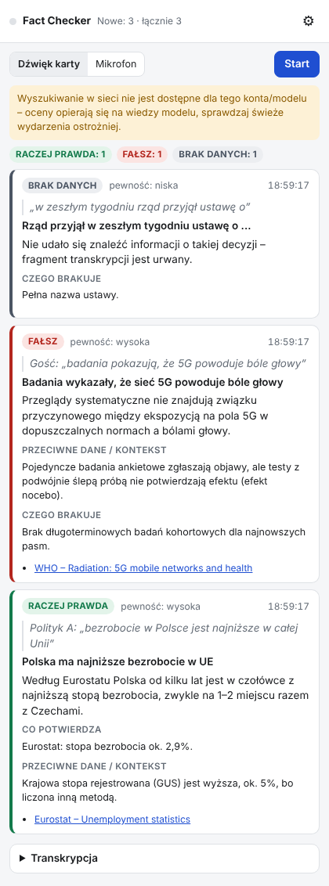
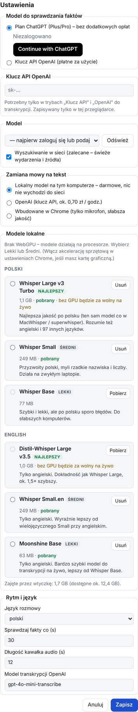

# Fact Checker — live fact-checking in Chrome

**[English](#english) · [Polski](#polski)**

 

<sub>The screenshots show sample responses from a test run, not real fact-checks.</sub>

---

## English

A Chrome extension that listens to a conversation playing in a tab (interview, debate, podcast, live stream) and
fact-checks it as it happens, in a side panel.

Every ~30 seconds it picks out the claims in the new speech that can be checked (numbers and statistics, references to studies,
events, quotes, laws, historical facts) and shows a verdict for each:

**True · Mostly true · Half-true · Misleading · False · No data · Unverifiable**

Each card also shows the exact quote, a short explanation, what supports the claim, **contradicting studies or data**,
**what is missing** to settle it, and links to sources. When a speaker cites research, the model checks whether such research
exists, what it actually says and whether other studies reach the opposite conclusion.

### How it works

| Step | How | Cost |
|---|---|---|
| Capture audio | The tab's audio (you keep hearing it), or the microphone | — |
| Speech → text | **Local model on your computer** (Whisper / Moonshine in the browser, GPU via WebGPU or CPU). Optional: OpenAI API, or Chrome's built-in speech recognition (microphone only) | free / offline |
| Fact-checking | OpenAI model via **Sign in with ChatGPT** (uses your ChatGPT Plus/Pro plan) or an OpenAI API key, with web search when available | included in your plan |

So with a ChatGPT subscription the whole thing costs nothing extra: transcription runs locally, and fact-checking uses your plan.

**Why not a Claude subscription?** Since February 2026 Anthropic does not allow Claude Free/Pro/Max logins in third-party apps.
Claude could only be added through a paid API key.

**Limits of the ChatGPT plan mode** (OpenAI's program is in preview, as of November 2026): no audio transcription (hence the local
models), and web search depends on the model and account. If OpenAI rejects web search, the extension switches to the model's own
knowledge and shows a warning (recent events will more often get “No data”). Usage counts toward your plan limits; you can set a
per-app cap in [ChatGPT → Settings → Usage](https://chatgpt.com/settings/usage).

### Local speech models

Download a model once in ⚙ Settings → **Local models**. After that it works offline and nothing leaves your computer.

| Language | Tier | Model | Download (GPU / CPU) | Test result* |
|---|---|---|---|---|
| Polish | Best | Whisper Large v3 Turbo | 1.6 GB / 1.1 GB | 21.6% word error rate; needs a GPU for live use |
| Polish | Medium | Whisper Small | 410 MB / 249 MB | 52.7% WER, ~1.5 s per 1 s of audio on CPU |
| Polish | Light | Whisper Base | 165 MB / 77 MB | weak for Polish |
| English | Best | Distil-Whisper Large v3.5 | 1.6 GB / 1.0 GB | 0% WER; needs a GPU for live use |
| English | Medium | Whisper Small.en | 410 MB / 249 MB | 0% WER |
| English | Light | Moonshine Base | 113 MB / 63 MB | 0% WER, 1.4 s for 11 s of audio |

<sub>* Tested in Chromium without a GPU (CPU builds, q8 quantization). Polish: 45 s of read sentences with very quiet audio (FLEURS);
English: an 11-second speech clip. On a GPU the models run faster and at higher precision (fp16).</sub>

With a GPU (any Apple Silicon Mac, most Windows PCs) pick **Best**; without one, **Medium**. Whisper Large v3 Turbo also understands
English, so one model covers both languages. The extension cuts audio at pauses, boosts quiet speech and filters typical Whisper
hallucinations (e.g. “Subtitles by the Amara.org community”, repetition loops).

### Installation

1. Download the code: **Code → Download ZIP** on GitHub and unzip it, or `git clone https://github.com/dawidadach/fact-checker.git`.
2. Open `chrome://extensions` and turn on **Developer mode** (top right).
3. Click **Load unpacked** and select the folder that contains `manifest.json`.
4. Pin the extension: puzzle icon → pin.

Requires Chrome 116 or newer.

### Usage

1. Open the tab with the conversation (YouTube, news stream, podcast…) and **click the Fact Checker icon while on that tab**.
   The side panel opens and Chrome allows the extension to record that tab. If you skip this step or switch tabs, Chrome will show
   a “Share a tab” window after you press Start: choose the tab and keep “Also share tab audio” on.
2. Open ⚙ **Settings**:
   - **Fact-checking model:** choose *ChatGPT plan* → **Continue with ChatGPT**, sign in and allow plan usage (a tab opens and closes
     itself), or paste an OpenAI API key.
   - **Local models:** download a model and select it.
   - **Conversation language:** Polish or English.
3. Choose the source: **Tab audio** (recommended) or **Microphone** (Chrome asks for permission in a separate tab the first time).
4. Press **Start**. Verdict cards appear at the top, newest first.

In the **Transcript** section you can also press **Check now**, paste any text to check, or **Export** everything to Markdown.

The interface is currently in Polish.

### Updating without losing settings

The extension has a fixed ID (`key` in `manifest.json`), so your ChatGPT login, settings and downloaded models survive updates.

1. Replace the files in the same folder with the new version (or `git pull`).
2. In `chrome://extensions` click **↻ (reload)** on Fact Checker. The version number is shown in the Settings header.

Do **not** click **Remove**: removing an extension deletes its data in Chrome (login and models).

### Privacy

- Audio is processed locally when you use a local model. Only the transcribed text is sent to OpenAI for fact-checking.
- The ChatGPT login tokens and the API key are stored only in this browser (`chrome.storage.local`).
- Sign in with ChatGPT gives the extension your name and email, not your ChatGPT conversations.

### Project structure

```
background.js          service worker: opens the panel, handles the ChatGPT sign-in callback
sidepanel.*            the side panel UI and the live checking loop
lib/auth.js            Sign in with ChatGPT: PKCE, dynamic client registration, ID-token check via JWKS, token refresh
lib/llm.js             OpenAI Responses API (streaming, store:false)
lib/factcheck.js       prompt, JSON schema of verdicts, parsing, duplicate detection
lib/transcribe.js      tab/mic capture, cutting at pauses, local / OpenAI / Chrome transcription
lib/models.js          local model catalog, download/delete, hallucination filter
lib/whisper-worker.js  worker that runs the speech model
lib/pcm-worklet.js     AudioWorklet that delivers 16 kHz audio
vendor/                transformers.js 4.3.2 and ONNX Runtime Web (bundled: extensions may not load code from a CDN)
tests/                 unit tests
```

The extension cannot listen on a network port, so the sign-in redirect to `http://127.0.0.1:1457/auth/callback` is intercepted with
`chrome.webRequest` and the extension exchanges the code itself.

### Tests

```bash
node --test tests/*.test.mjs
```

Unit tests cover SSE stream parsing, request building (no fields that the ChatGPT plan mode forbids), verdict parsing, duplicate
detection, PKCE (RFC 7636 test vector), ID-token validation, audio segmentation at pauses, quiet speech, gain normalization and the
hallucination filter.

### Status

Tested in Chromium with OpenAI's servers stubbed: sign-in flow, model list, fact-checking, automatic fallback when web search is
rejected. All six local models were downloaded and run on real speech, and capturing a tab through the share window was tested.
**Not yet tested:** a real sign-in with a ChatGPT Plus account, direct tab capture after clicking the icon, and the models on a GPU
(WebGPU). If something fails, right-click the panel → **Inspect** and check the Console.

---

## Polski

Wtyczka Chrome, która słucha rozmowy odtwarzanej w karcie (wywiad, debata, podcast, transmisja) i na bieżąco sprawdza fakty
w panelu bocznym.

Co ok. 30 sekund wyłapuje z nowej części rozmowy twierdzenia, które da się sprawdzić (liczby i statystyki, powoływanie się na badania,
wydarzenia, cytaty, przepisy, fakty historyczne), i pokazuje werdykt:

**Prawda · Raczej prawda · Półprawda · Wprowadza w błąd · Fałsz · Brak danych · Nieweryfikowalne**

Każda karta zawiera dosłowny cytat, krótkie wyjaśnienie, co potwierdza twierdzenie, **przeciwne badania lub dane**,
**czego brakuje** do rozstrzygnięcia i linki do źródeł. Gdy ktoś powołuje się na badania, model sprawdza, czy takie badania
istnieją, co naprawdę mówią i czy są badania o przeciwnych wnioskach.

### Jak to działa

| Krok | Jak | Koszt |
|---|---|---|
| Nagranie dźwięku | Dźwięk karty (dalej go słyszysz) albo mikrofon | — |
| Mowa → tekst | **Lokalny model na Twoim komputerze** (Whisper / Moonshine w przeglądarce, na karcie graficznej przez WebGPU albo na procesorze). Opcjonalnie: OpenAI API albo rozpoznawanie mowy wbudowane w Chrome (tylko mikrofon) | darmowe / offline |
| Sprawdzanie faktów | Model OpenAI przez **Sign in with ChatGPT** (Twój plan ChatGPT Plus/Pro) albo klucz API OpenAI, z wyszukiwaniem w sieci, gdy jest dostępne | w ramach planu |

Z subskrypcją ChatGPT całość nic dodatkowo nie kosztuje: transkrypcja działa lokalnie, a sprawdzanie faktów korzysta z planu.

**Dlaczego nie subskrypcja Claude?** Od lutego 2026 Anthropic nie pozwala używać logowania Claude Free/Pro/Max w aplikacjach innych
firm. Claude dałoby się dodać tylko przez płatny klucz API.

**Ograniczenia trybu planu ChatGPT** (program OpenAI jest w wersji preview, stan na listopad 2026): brak transkrypcji mowy (dlatego
lokalne modele), a wyszukiwanie w sieci zależy od modelu i konta. Jeśli OpenAI odrzuci wyszukiwanie, wtyczka przełącza się na wiedzę
modelu i pokazuje ostrzeżenie (świeże wydarzenia częściej dostaną „Brak danych”). Zużycie wlicza się do limitów planu; limit dla
tej wtyczki ustawisz w [ChatGPT → Settings → Usage](https://chatgpt.com/settings/usage).

### Lokalne modele mowy

Model pobierasz raz w ⚙ Ustawienia → **Modele lokalne**. Potem działa bez internetu i nic nie wychodzi z komputera.

| Język | Poziom | Model | Pobranie (GPU / CPU) | Wynik testu* |
|---|---|---|---|---|
| Polski | Najlepszy | Whisper Large v3 Turbo | 1,6 GB / 1,1 GB | 21,6% błędnych słów; na żywo potrzebuje karty graficznej |
| Polski | Średni | Whisper Small | 410 MB / 249 MB | 52,7% błędnych słów, ok. 1,5 s na 1 s nagrania na CPU |
| Polski | Lekki | Whisper Base | 165 MB / 77 MB | słaby po polsku |
| English | Najlepszy | Distil-Whisper Large v3.5 | 1,6 GB / 1,0 GB | 0% błędów; na żywo potrzebuje karty graficznej |
| English | Średni | Whisper Small.en | 410 MB / 249 MB | 0% błędów |
| English | Lekki | Moonshine Base | 113 MB / 63 MB | 0% błędów, 1,4 s na 11 s nagrania |

<sub>* Test w Chromium bez karty graficznej (wersje CPU, kwantyzacja q8). Polski: 45 s czytanych zdań z bardzo cichym nagraniem
(FLEURS), angielski: 11-sekundowy fragment przemówienia. Na karcie graficznej modele działają szybciej i w lepszej precyzji (fp16).</sub>

Z kartą graficzną (każdy Mac z Apple Silicon, większość komputerów z Windows) wybierz **Najlepszy**, bez niej **Średni**.
Whisper Large v3 Turbo rozumie też angielski, więc jeden model wystarcza do obu języków. Wtyczka tnie nagranie w przerwach w mowie,
podgłaśnia cichy dźwięk i wycina typowe „halucynacje” Whispera (np. „Napisy stworzone przez społeczność Amara.org”, pętle powtórzeń).

### Instalacja

1. Pobierz kod: na GitHubie **Code → Download ZIP** i rozpakuj, albo `git clone https://github.com/dawidadach/fact-checker.git`.
2. Wejdź na `chrome://extensions` i włącz **Tryb dewelopera** (prawy górny róg).
3. Kliknij **Załaduj rozpakowane** i wskaż folder, w którym jest `manifest.json`.
4. Przypnij wtyczkę: ikona puzzla → pinezka.

Wymaga Chrome 116 lub nowszego.

### Użycie

1. Otwórz kartę z rozmową (YouTube, TVN24 GO, podcast…) i **kliknij ikonę Fact Checkera, będąc na tej karcie**.
   Otworzy się panel, a Chrome pozwoli wtyczce nagrywać tę kartę. Jeśli tego nie zrobisz albo przełączysz kartę, po kliknięciu Start
   Chrome pokaże okno „Udostępnij kartę”: wybierz kartę z rozmową i zostaw włączone udostępnianie dźwięku.
2. Otwórz ⚙ **Ustawienia**:
   - **Model do sprawdzania faktów:** *Plan ChatGPT* → **Continue with ChatGPT**, zaloguj się i zgódź na użycie planu (otworzy się
     karta, która sama się zamknie), albo wklej klucz API OpenAI.
   - **Modele lokalne:** pobierz model i go zaznacz.
   - **Język rozmowy:** polski albo angielski.
3. Wybierz źródło: **Dźwięk karty** (zalecane) albo **Mikrofon** (za pierwszym razem Chrome poprosi o zgodę w osobnej karcie).
4. Kliknij **Start**. Karty z werdyktami pojawiają się na górze, najnowsze pierwsze.

W sekcji **Transkrypcja** możesz też kliknąć **Sprawdź teraz**, wkleić dowolny tekst do sprawdzenia albo **wyeksportować** całość do Markdown.

### Aktualizacja bez utraty ustawień

Wtyczka ma stały identyfikator (`key` w `manifest.json`), więc logowanie ChatGPT, ustawienia i pobrane modele zostają po aktualizacji.

1. Podmień pliki w tym samym folderze na nową wersję (albo `git pull`).
2. W `chrome://extensions` kliknij **↻ (odśwież)** przy Fact Checkerze. Numer wersji widać w nagłówku Ustawień.

**Nie** klikaj **Usuń**: usunięcie wtyczki kasuje w Chrome jej dane (logowanie i modele).

### Prywatność

- Przy lokalnym modelu dźwięk jest przetwarzany na Twoim komputerze. Do OpenAI trafia tylko tekst transkrypcji, do sprawdzenia faktów.
- Tokeny logowania ChatGPT i klucz API są zapisane tylko w tej przeglądarce (`chrome.storage.local`).
- Sign in with ChatGPT przekazuje wtyczce imię i e-mail, nie Twoje rozmowy z ChatGPT.

### Testy

```bash
node --test tests/*.test.mjs
```

### Stan projektu

Przetestowane w Chromium z podstawionymi serwerami OpenAI: logowanie, lista modeli, sprawdzanie faktów, automatyczne wyłączenie
wyszukiwania po odmowie. Wszystkie sześć lokalnych modeli zostało pobranych i uruchomionych na prawdziwej mowie, sprawdzone też
nagrywanie karty przez okno „Udostępnij kartę”. **Jeszcze nie sprawdzone:** prawdziwe logowanie na koncie ChatGPT Plus, bezpośrednie
nagrywanie karty po kliknięciu ikony i modele na karcie graficznej (WebGPU). Jeśli coś nie działa, kliknij prawym przyciskiem
w panelu → **Zbadaj** i sprawdź zakładkę Console.
