# Fact Checker — fact-check posts, articles and memes in Chrome, Edge and Opera

Point at a Facebook or X post, a news article or a meme and get verdicts with sources, an overall rating, a scam warning and a
ready reply to paste. It also checks debates and podcasts live.

Developed by [Dawid Adach](https://github.com/dawidadach) and [Wojciech Kałużny](https://github.com/wojciechkaluzny-ctrl) · Projekt rozwijają Dawid Adach i Wojciech Kałużny.

Website · Strona projektu: **[factchecker.pl](https://factchecker.pl)**

**[English](#english) · [Polski](#polski)**

### Install in 1 minute

1. Download the package for your browser (latest release):
   **[Chrome](https://github.com/dawidadach/fact-checker/releases/latest/download/fact-checker-chrome.zip)** ·
   **[Edge](https://github.com/dawidadach/fact-checker/releases/latest/download/fact-checker-edge.zip)** ·
   **[Opera](https://github.com/dawidadach/fact-checker/releases/latest/download/fact-checker-opera.zip)** — and unzip it.
2. Open **`chrome://extensions`** / **`edge://extensions`** / **`opera://extensions`** and switch on **Developer mode**.
3. Click **Load unpacked** and pick the unzipped folder (the one with `manifest.json`).
4. Click the extension icon → ⚙ → choose who checks the facts (ChatGPT plan, OpenAI, Gemini, Claude or OpenRouter).
   Then point at a post with 👆, an article with 📄, a fragment with ✂ or any part of the screen with 🔲 — or press **Start**
   to check a debate live.

### Instalacja w minutę

1. Pobierz paczkę dla swojej przeglądarki (najnowsze wydanie):
   **[Chrome](https://github.com/dawidadach/fact-checker/releases/latest/download/fact-checker-chrome.zip)** ·
   **[Edge](https://github.com/dawidadach/fact-checker/releases/latest/download/fact-checker-edge.zip)** ·
   **[Opera](https://github.com/dawidadach/fact-checker/releases/latest/download/fact-checker-opera.zip)** — i rozpakuj.
2. Wejdź na **`chrome://extensions`** / **`edge://extensions`** / **`opera://extensions`** i włącz **Tryb dewelopera**.
3. Kliknij **Załaduj rozpakowane** i wskaż rozpakowany folder (ten z plikiem `manifest.json`).
4. Kliknij ikonę wtyczki → ⚙ → wybierz, kto sprawdza fakty (plan ChatGPT, OpenAI, Gemini, Claude albo OpenRouter).
   Potem wskaż post przyciskiem 👆, artykuł 📄, fragment ✂ albo dowolny kawałek ekranu 🔲 – albo kliknij **Start**, żeby
   sprawdzać debatę na żywo.

Full guide in Polish: **[INSTRUKCJA.md](INSTRUKCJA.md)** · What's new: **[CHANGELOG.md](CHANGELOG.md)** ·
Privacy: **[PRIVACY.md](PRIVACY.md)**

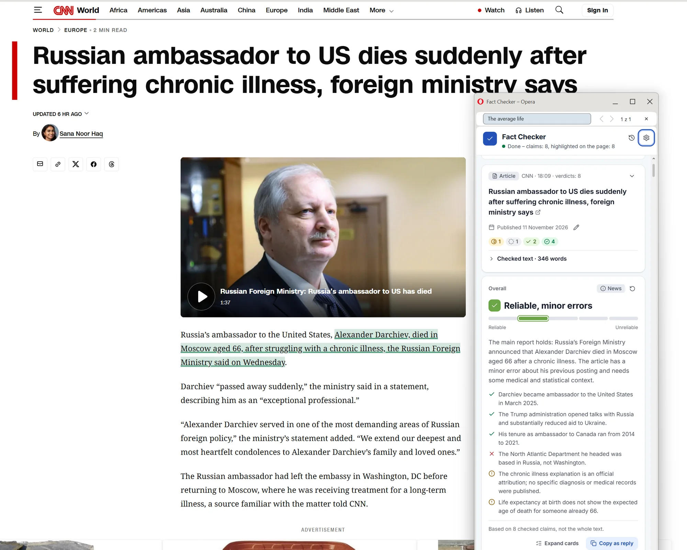

---

## English

Website: **[factchecker.pl](https://factchecker.pl)** – features, screenshots and downloads in one place.

A browser extension (Chrome, Edge, Opera) that checks what you read and watch, in a side panel:

- **Posts and articles** — a Facebook or X post, a news article, a selected fragment. Only what you point at is read.
- **Memes, infographics, charts and photos** — the text in the image and the way it is presented.
- **Debates and podcasts** — a video or stream playing in a tab, or the microphone, checked live every ~30 seconds.

Every claim that can be checked (numbers and statistics, references to studies, events, quotes, laws, historical facts) gets a
verdict with sources:

**True · Mostly true · Half-true · Misleading · False · No data · Unverifiable · Satire**

### Checking posts, articles and memes

**Pointing at content** (nothing is read until you do)
- ✓ **Icon on posts** (optional) – hover over a Facebook or X post and a Fact Checker icon appears in its top-right
  corner, left of “…”; one click checks that post and shows the result in a box right under it (overall rating, verdicts, sources, “Copy as
  reply”). Off by default and switched on separately for Facebook and X; the browser asks for access only to the site you switch on.
- ✓ **Icon on articles** (optional) – hover over a news article's headline and the icon appears at its end; one click checks
  the whole article, then a rating badge (e.g. “Misleading”) stays next to the headline – and comes back on your next visit.
  Three modes: off (default), **selected sites** (about 90 of the biggest Polish and international news sites – Onet, WP,
  Interia, TVN24, Rzeczpospolita, wPolityce, OKO.press, BBC, NYT, Reuters, Fox News, Spiegel… – each can be unticked,
  “Select all” per group, and you can add the site you are on) or **everywhere** (any page that looks like an article).
- 👆 **Pick a post** – one Facebook / X post without the comments, with its images; Shift+click to pick several.
- 📄 **Article** – only the article text (Mozilla Readability), without menus, ads and comments.
- ✂ **Selection**, or right-click → Fact Checker, or **Alt+Shift+F**.
- 🔲 **Screen area** – drag a rectangle around anything: a chart in a video, a screenshot, a comment.
- You see a preview before anything is sent. Verdicts are **highlighted on the page** in the verdict's colour, with a tooltip.

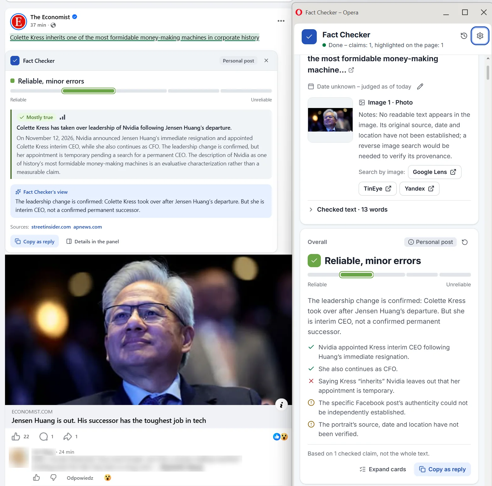

**What you get**
- **Overall rating** above the cards – one of five named levels: *Reliable* · *Reliable, minor errors* · *Mixed* ·
  *Misleading* · *Unreliable*. One or two sentences on what the piece says and whether it holds, plus ✓ what holds,
  ✗ what is false, ⚠ what is missing and ⚖ whose side is missing. It also names the **kind of content**: news, opinion,
  *opinion presented as news*, campaign material, *advertising*, satire, *possible scam*.
  The level follows the weight of the claims, not their count: a false main message weighs more than a false detail.
- **Verdict cards** – the exact quote and who said it, the claim being checked, a short explanation, what supports it,
  contradicting data or context, what is missing and links to sources. Cards fold to one line with the problems on top;
  click one for the details.
- **⚠ Scam warning** – fake “investment” ads with famous faces, look-alike addresses (`tvn24-news.online`,
  `allegro.pl.oferta-24.com`, `a11egro.pl`), the **CERT Polska warning list** (the whole public list is downloaded and checked
  locally), links hidden behind Facebook redirects and typical wording (“earns 5000 zł a day”, “only 7 spots left”,
  “parcel fee”, BLIK codes). Detection runs in the browser and costs 0 tokens.
- **🎭 Rhetorical tricks** – false dilemma, attack on the person, straw man, whataboutism, cherry-picking and 10 more, each with
  the quote, why it is a trick and how to answer. Not a verdict – it is about how the argument is made.
- **Memes, infographics and photos** – the model reads the text in the image and checks fake quotes, misleading charts
  (truncated axes, cherry-picked ranges), screenshots of posts and satire. Reverse image search (Google Lens, TinEye, Yandex) for
  photos taken out of context.

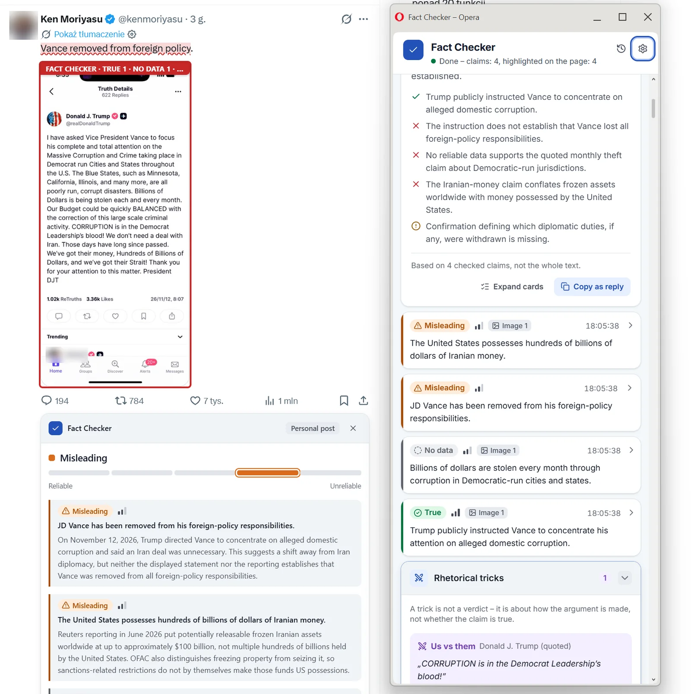

**Answering under the post**
- **📋 Copy as reply** – opens on the *Original* verdict text right away (no AI, free); the model writes a comment in
  plain language matched to the post only when you pick a tone: *Matter-of-fact*, *Casual* or *Short for X* (fits 280
  characters). Sources are added as plain links.
- **Whole post** – “Copy as reply” under the overall rating gives one comment covering all verdicts, starting from the
  overall rating and the main message.

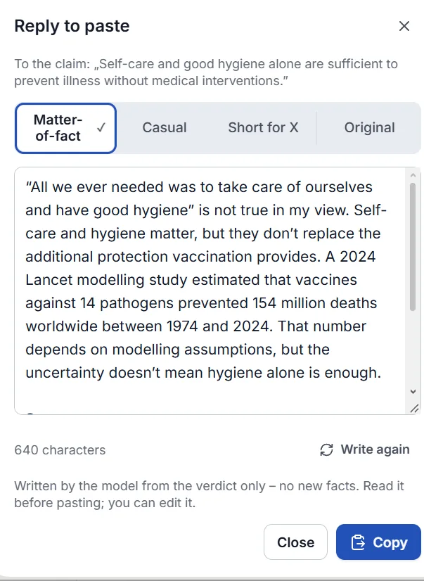

### Better verdicts

- **Primary sources first** (e.g. for Poland: Sejm votes and transcripts, ISAP, GUS, NBP, Eurostat).
- **Source level** next to every link – *data*, *document*, *science*, *government*, *poll*, *fact-check*, *media*,
  *social media* – recognised from the address, no model involved.
- **Existing fact-checks** (optional, free Google key): articles by fact-checking outlets from the Google Fact Check database,
  with a ⚠ warning when an outlet rated the claim differently.
- **🔍 Check more thoroughly** (under every verdict): one claim is checked again from scratch in thorough mode, with your
  optional note as a hint – optionally with another provider as a second opinion. The card shows whether the verdict changed.
- **Verdict memory:** the same text or image (a meme that keeps circulating) gets its earlier result instantly, at no cost.
  Every image is recognised on its own, also in another post; the same meme template with a different caption is not.
- **Date of the statement:** an old post or interview is judged by the facts of that time.

### Live debates and podcasts

- **Tab audio or microphone**: open the video or stream, press **Start**, and verdicts appear as people speak.
- ✓ **Icon in the YouTube player** (optional): one click on the icon next to the subtitles button starts listening to that
  video right away – no Start, no picking a tab. The sound is taken straight from the video (it keeps playing normally,
  the tab is not muted); click again to stop. Off by default; the browser asks for access to youtube.com only.
- Speech is turned into text by a **local model on your computer** (free, offline) – the first **Start** offers the right one
  and downloads it – or by OpenAI.
- **Speaking now:** mark who is speaking; verdicts, tricks and the report are attributed to that person.
- **Report:** the whole debate as a document – verdict breakdown, speakers table (claims, true, problems, tricks), all verdicts
  with sources; print / save as PDF or download as HTML.

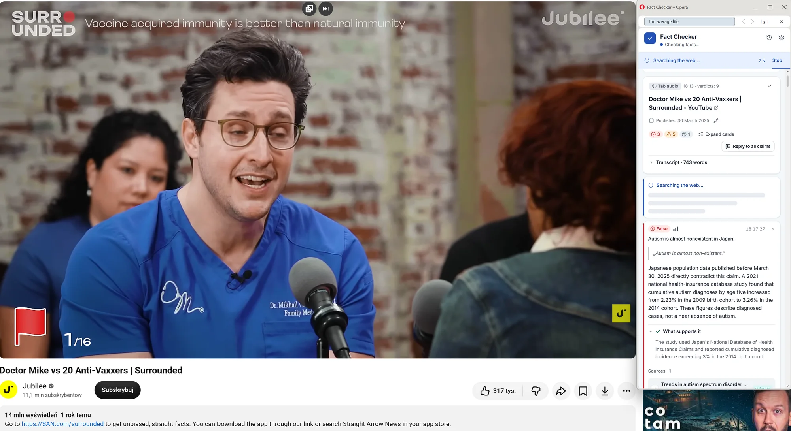

### Sessions, costs and privacy

- Everything you check goes into the current session, grouped by source; 🕘 History with search, reopening, export and deleting.
  A **queue** lets you point at more posts while one is being checked.
- **Cost counter** for the session and the day, an optional **daily spending limit**, and three modes: *Economy* / *Normal* /
  *Thorough*.
- **Hide people:** blur profile pictures and author names on screenshots and do not send the post author.
- **Export of re-checks** as JSON (verdict before and after, your note, context) to improve the prompts. Filter
  **Only problems**, Markdown export.
- No analytics, no server of our own; API keys can be kept only until the browser closes — see [PRIVACY.md](PRIVACY.md).

### Who checks the facts

| Provider | What you need | Web search | Images |
|---|---|---|---|
| **ChatGPT plan** | Sign in with your ChatGPT Plus/Pro account | depends on model and account | yes |
| **OpenAI** | API key (pay per use) | yes | yes |
| **Google Gemini** | API key – has a free tier | yes (Google Search; free monthly quota) | yes |
| **Anthropic Claude** | API key (pay per use) | yes (enable it in the Anthropic console) | yes |
| **OpenRouter** | one key, many models (Claude, Gemini, GPT, free models) | yes | depends on the model |

Anthropic does not allow Claude Free/Pro/Max logins in third-party apps, so Claude works only with an API key.
With the ChatGPT plan the extension costs nothing extra: fact-checking uses your plan and transcription runs locally
(OpenAI's program is in preview; usage counts toward your plan limits, see
[ChatGPT → Settings → Usage](https://chatgpt.com/settings/usage)).

### Installation

Download the package for your browser from the **[latest release](https://github.com/dawidadach/fact-checker/releases/latest)**
and unzip it.

| | Chrome | Edge | Opera |
|---|---|---|---|
| Package | `fact-checker-chrome.zip` | `fact-checker-edge.zip` | `fact-checker-opera.zip` |
| Extensions page | `chrome://extensions` | `edge://extensions` | `opera://extensions` |
| Developer mode | top right | left panel, bottom | top right |
| Panel | Chrome side panel | Edge side panel | Opera sidebar, or a small window next to the browser |
| Built-in speech recognition | yes (microphone) | yes (microphone) | no – use a local model or OpenAI |

Then **Load unpacked** → the unzipped folder, and pin the icon (puzzle icon → pin / eye). Requires a Chromium-based browser
version 116 or newer. The repository root is the Chrome version, so a `git clone` can also be loaded directly in Chrome or Edge.

**Updating without losing settings:** replace the files in the same folder and click **↻ Reload** on the extension.
Do **not** click **Remove** — that deletes the extension's data (sign-in, keys, models, history). The extension has a fixed ID
(`key` in `manifest.json`), so everything survives updates.

### Usage

1. **A post, an article or an image:** open the page, click the Fact Checker icon and use 👆 Pick a post, 📄 Article,
   ✂ Selection or 🔲 Screen area – or right-click → Fact Checker. Longer texts and all images show a preview first.
2. **A debate or podcast:** open the tab with the video, click the Fact Checker icon **while on that tab**, choose
   **Tab audio** or **Microphone** and press **Start**.
3. In ⚙ **Settings** the languages are at the top; below them the provider and model, the checking mode, the daily limit and
   scam protection, and – grouped under **Listening live** – speech to text, local models and the listening rhythm.

The interface is in English or Polish (from the browser language, changeable in Settings). Verdicts are written in the
interface language; quotes stay in the original language.

### Local speech models (only for listening)

Articles, posts and images are checked without a speech model. The first time you press **Start**, Fact Checker offers the
model that fits your language and computer and downloads it with a progress bar (or lets you use OpenAI or the browser's
built-in recognition). After that it works offline and nothing leaves your computer.

| Language | Tier | Model | Download (GPU / CPU) | Test result* |
|---|---|---|---|---|
| Polish | Best | Whisper Large v3 Turbo | 1.6 GB / 1.1 GB | 21.6% word error rate; needs a GPU for live use |
| Polish | Medium | Whisper Small | 410 MB / 249 MB | 52.7% WER, ~1.5 s per 1 s of audio on CPU |
| Polish | Light | Whisper Base | 165 MB / 77 MB | weak for Polish |
| English | Best | Distil-Whisper Large v3.5 | 1.6 GB / 1.0 GB | 0% WER; needs a GPU for live use |
| English | Medium | Whisper Small.en | 410 MB / 249 MB | 0% WER |
| English | Light | Moonshine Base | 113 MB / 63 MB | 0% WER, 1.4 s for 11 s of audio |

<sub>* Tested in Chromium without a GPU (CPU builds, q8 quantization). Polish: 45 s of read sentences with very quiet audio (FLEURS);
English: an 11-second speech clip. On a GPU the models run faster and at higher precision (fp16).</sub>

### Privacy

- Page text and images are sent to the model provider you chose only after you point at them (or click a post's button), and you see a preview first – except for the one-click post button.
- The optional post icon gives the extension access to facebook.com and/or x.com (each switched on separately) only to show the icon when you hover over a post; a post is read when you click its icon.
- The optional YouTube player icon gives the extension access to youtube.com only to show the icon in the player; it listens to the video only after you click it.
- The optional article icon gives the extension access to the news sites you keep ticked (or, with “Everywhere”, to all sites) only to recognise an article by the page's structure and show the icon when you hover over its headline; the article is read when you click the icon.
- Scam checks and source levels run in the browser; the CERT Polska list is downloaded whole, so nobody learns what you check.
- With a local speech model, audio stays on your computer; only text goes to the model provider.
- Keys and sign-in tokens stay in this browser. Details: [PRIVACY.md](PRIVACY.md).

### Project structure

```
manifest.json          Chrome/Edge manifest (the Opera manifest is generated by scripts/build.mjs)
background.js          service worker: panel, context menu, shortcut, screenshots of images, ChatGPT sign-in callback
sidepanel.*            the side panel UI: page checks, queue, cards, live checking loop, settings
content/page.*         page script (injected only on user action): article / post / selection / area, links, highlighting
content/buttons.js     optional hover icon and result box on Facebook / X posts (registered only when the option is on)
fc-tokens.css          design tokens (colours, type, spacing; light + dark) – shared by the panel and the result box on posts
fc-components.css      design components (.fc-*): buttons, pills, verdict cards, overall rating, scam alert, settings…
fonts/                 Inter (bundled, SIL OFL 1.1) – the panel does not load Google Fonts
lib/icons.js           Lucide icons used by the panel (ISC licence: lib/LUCIDE-LICENSE.txt)
report.*, privacy.*    session report page, privacy policy page
lib/factcheck.js       prompts, JSON schema of verdicts, parsing, duplicate detection
lib/summary.js         overall rating: levels, kind of content, guard against the verdicts, card order
lib/scam.js            scam signals: look-alike addresses, brand impersonation, typical wording
lib/certlist.js        CERT Polska warning list: download, local cache, domain lookup
lib/tricks.js          rhetorical tricks: dictionary (PL/EN definitions and answers), prompt part, parsing
lib/sourcetier.js      source level from the domain (data, document, science, government, poll, media…)
lib/reply.js           “Copy as reply”: prompts, tones, plain-text sources
lib/memory.js          verdict memory: text hashes and image fingerprints
lib/factcheckapi.js    Google Fact Check Tools (existing fact-checks)
lib/capture.js         running the page script in a tab
lib/shot.js            screenshots of the visible images / screen area
lib/history.js         sessions (IndexedDB), Markdown export, ratings export
lib/report.js          session report (HTML)
lib/pricing.js         price lists, cost counter, checking modes
lib/auth.js            Sign in with ChatGPT (PKCE, dynamic client registration, token refresh)
lib/llm.js             OpenAI Responses API (streaming, timeouts)
lib/providers.js       Gemini, Claude and OpenRouter adapters (same request format as OpenAI)
lib/transcribe.js      tab/mic capture, cutting at pauses, local / OpenAI / browser transcription
lib/models.js          local speech models
lib/i18n.js            interface translations (English, Polish)
lib/vendor/            Mozilla Readability (Apache 2.0)
vendor/                transformers.js and ONNX Runtime Web (bundled: extensions may not load code from a CDN)
scripts/build.mjs      builds dist/fact-checker-{chrome,edge,opera}(.zip)
tests/                 unit tests
```

### Building and tests

```bash
npm test         # unit tests (node --test)
npm run build    # dist/fact-checker-chrome.zip, dist/fact-checker-edge.zip, dist/fact-checker-opera.zip
```

### Third-party assets

- **Inter** font (rsms/inter) – SIL Open Font License 1.1, `fonts/Inter-OFL.txt`.
- **Lucide** icons – ISC License, `lib/LUCIDE-LICENSE.txt`.
- **Mozilla Readability** – Apache License 2.0 (`lib/vendor/`).

### Authors

Fact Checker is developed by [Dawid Adach](https://github.com/dawidadach) and [Wojciech Kałużny](https://github.com/wojciechkaluzny-ctrl).

### Status

Checking posts, images and replies was used on real Facebook and X posts and news articles with the ChatGPT plan; the live
features on real YouTube debates in Polish and English (see the screenshots). All features are covered by unit tests and by
end-to-end tests in Chromium with the model providers stubbed; Gemini, Claude and OpenRouter have so far been tested only
against stubbed servers. If something fails, right-click the panel → **Inspect**, check the Console and open an issue.

---

## Polski

Strona projektu: **[factchecker.pl](https://factchecker.pl)** – funkcje, zrzuty ekranu i pobieranie w jednym miejscu.

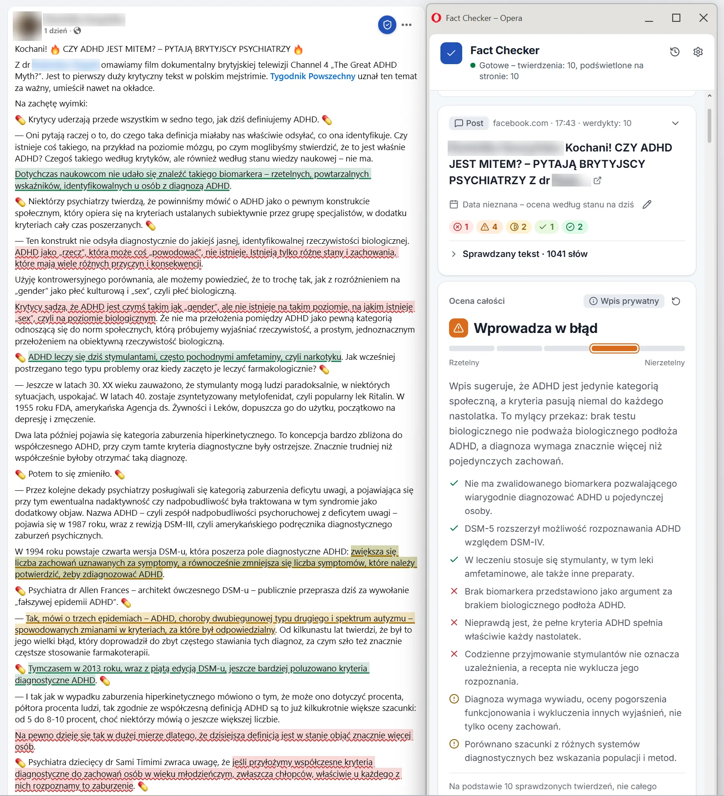

Wtyczka do przeglądarki (Chrome, Edge, Opera), która w panelu bocznym sprawdza fakty w tym, co czytasz i oglądasz:

- **Posty i artykuły** – post z Facebooka albo X, artykuł, zaznaczony fragment. Czyta tylko to, co wskażesz.
- **Memy, infografiki, wykresy i zdjęcia** – tekst na obrazku i sposób przedstawienia.
- **Debaty i podcasty** – film albo transmisja w karcie, albo mikrofon, sprawdzane na bieżąco co ok. 30 sekund.

Każde twierdzenie, które da się sprawdzić (liczby i statystyki, powoływanie się na badania, wydarzenia, cytaty, przepisy,
fakty historyczne), dostaje werdykt ze źródłami:

**Prawda · Raczej prawda · Półprawda · Wprowadza w błąd · Fałsz · Brak danych · Nieweryfikowalne · Satyra / żart**

### Sprawdzanie postów, artykułów i memów

**Jak wskazać treść** (nic nie jest czytane, dopóki tego nie zrobisz)
- ✓ **Ikonka przy postach** (opcja) – po najechaniu na post na Facebooku albo X w jego prawym górnym rogu, na lewo
  od „…”, pojawia się ikonka Fact Checkera; jedno kliknięcie sprawdza ten post i pokazuje wynik w ramce tuż pod nim (ocena całości, werdykty, źródła, „Kopiuj
  jako odpowiedź”). Domyślnie wyłączona, włączana osobno dla Facebooka i X; przeglądarka pyta o dostęp tylko do serwisu, który włączasz.
- ✓ **Ikonka przy artykułach** (opcja) – po najechaniu na tytuł artykułu na jego końcu pojawia się ikonka; jedno kliknięcie
  sprawdza cały artykuł, a potem przy tytule zostaje znaczek z oceną (np. „Wprowadza w błąd”) – wraca też przy kolejnej
  wizycie. Trzy tryby: wyłączone (domyślnie), **wybrane serwisy** (ok. 90 największych polskich i zagranicznych serwisów
  informacyjnych – Onet, WP, Interia, TVN24, Rzeczpospolita, wPolityce, OKO.press, BBC, NYT, Reuters, Fox News, Spiegel… –
  każdy można odznaczyć, „Zaznacz wszystkie” w grupie, można dodać stronę, na której jesteś) albo **wszędzie** (każda
  strona, która wygląda jak artykuł).
- 👆 **Wskaż post** – jeden post z Facebooka / X, bez komentarzy, razem z obrazkami; Shift+klik – kilka po kolei.
- 📄 **Artykuł** – sama treść artykułu (Mozilla Readability), bez menu, reklam i komentarzy.
- ✂ **Zaznaczenie**, prawy przycisk → Fact Checker albo **Alt+Shift+F**.
- 🔲 **Wycinek** ekranu – zaznaczasz prostokąt wokół czegokolwiek: wykresu w filmie, zrzutu, komentarza.
- Przed wysłaniem widzisz podgląd. Werdykty są **podświetlane na stronie** kolorem werdyktu, z dymkiem.

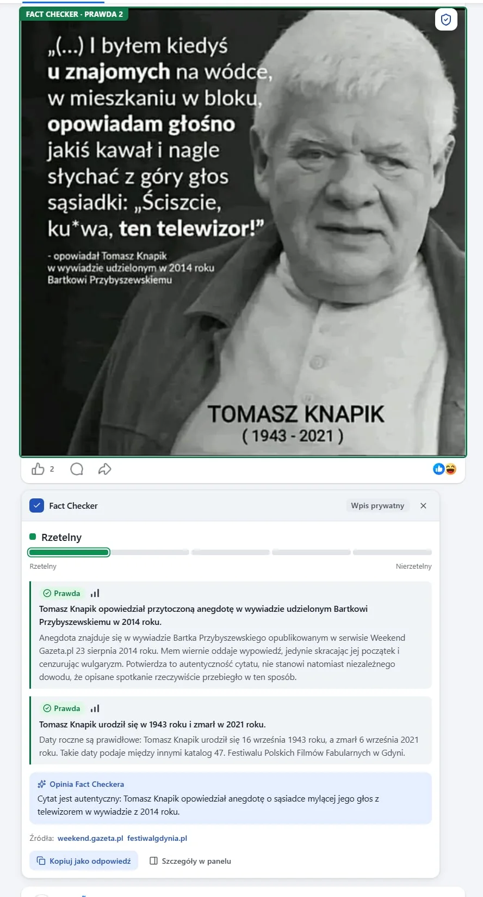

**Co dostajesz**
- **Ocena całości** nad kartami – jeden z pięciu nazwanych poziomów: *Rzetelny* · *Rzetelny, z drobnymi błędami* ·
  *Mieszany* · *Wprowadza w błąd* · *Nierzetelny*. Jedno-dwa zdania o tym, co tekst mówi i czy to się broni, a do tego
  ✓ co się zgadza, ✗ co jest fałszywe, ⚠ czego brakuje i ⚖ czyjej strony brakuje. Mówi też, jaki to **rodzaj treści**:
  wiadomość, opinia, *opinia podana jako wiadomość*, materiał wyborczy, *reklama*, satyra, *możliwe oszustwo*.
  Poziom zależy od wagi twierdzeń, nie od ich liczby: fałszywa główna teza waży więcej niż fałszywy szczegół.
- **Karty z werdyktami** – dosłowny cytat i kto go powiedział, sprawdzane twierdzenie, krótkie wyjaśnienie, co je potwierdza,
  przeciwne dane lub kontekst, czego brakuje i linki do źródeł. Karty zwijają się do jednej linii, problemy na górze;
  kliknij kartę, żeby zobaczyć szczegóły.
- **⚠ Ostrzeżenie przed oszustwem** – fałszywe reklamy „inwestycji” ze znanymi twarzami, adresy udające marki
  (`tvn24-news.online`, `allegro.pl.oferta-24.com`, `a11egro.pl`), **Lista Ostrzeżeń CERT Polska** (cała publiczna lista
  pobierana i sprawdzana u Ciebie), linki ukryte za przekierowaniem Facebooka i typowe sformułowania („zarabia 5000 zł
  dziennie”, „zostało 7 miejsc”, „dopłata do paczki”, kod BLIK). Wykrywanie działa w przeglądarce i nie zużywa tokenów.
- **🎭 Chwyty erystyczne** – fałszywy dylemat, atak na osobę, chochoł, „a u was…”, wybiórcze fakty i 10 innych: cytat,
  dlaczego to chwyt i jak odpowiedzieć. To nie werdykt – mówi o sposobie argumentowania.
- **Memy, infografiki i zdjęcia** – model odczytuje tekst na obrazku i sprawdza fałszywe cytaty, zmanipulowane wykresy
  (obcięte osie, wybrane zakresy), zrzuty postów i satyrę. Wyszukiwanie obrazem (Google Lens, TinEye, Yandex) – na zdjęcia
  wyrwane z kontekstu.

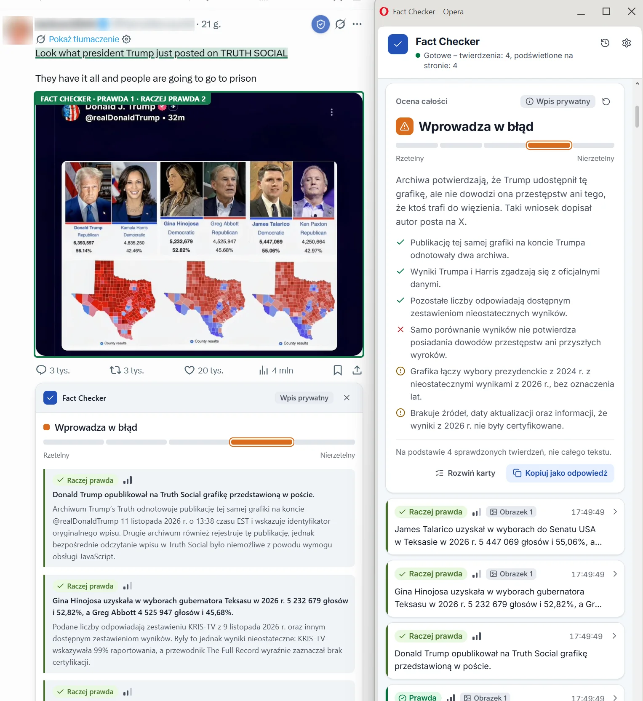

**Odpowiedź pod postem**
- **📋 Kopiuj jako odpowiedź** – od razu *Oryginał* werdyktu (bez AI, za darmo); komentarz ludzkim językiem, dopasowany
  do posta, model pisze dopiero po wybraniu tonu: *Rzeczowo*, *Na luzie* albo *Krótko pod X* (mieści się w 280 znakach).
  Źródła jako zwykłe linki.
- **Cały post** – „Kopiuj jako odpowiedź” pod oceną całości daje jeden komentarz do wszystkich werdyktów, zaczynający
  od oceny całości i głównej tezy.

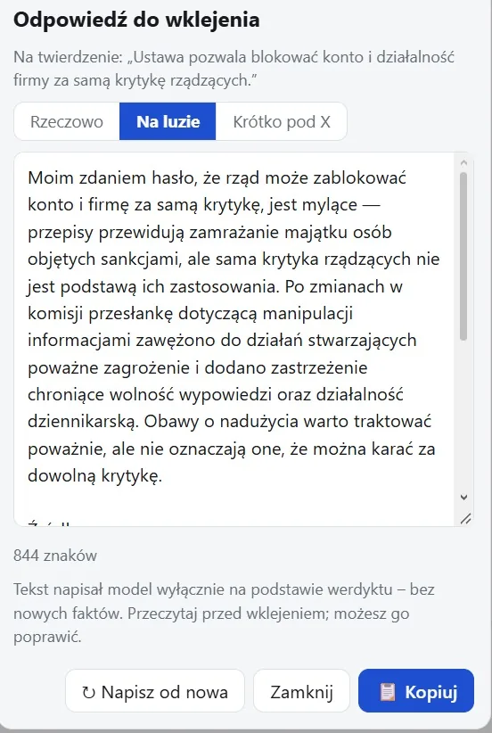

### Lepsze werdykty

- **Najpierw źródła pierwotne** (np. głosowania i stenogramy Sejmu, ISAP, GUS, NBP, Eurostat).
- **Poziom źródła** przy każdym linku – *dane*, *dokument*, *nauka*, *urząd*, *sondaż*, *fact-check*, *media*,
  *social media* – rozpoznawany po adresie, bez modelu.
- **Gotowe fact-checki** (opcjonalnie, darmowy klucz Google): artykuły redakcji fact-checkingowych z bazy Google Fact Check,
  z ostrzeżeniem ⚠, gdy redakcja oceniła coś inaczej.
- **🔍 Sprawdź dokładniej** (pod każdym werdyktem): jedno twierdzenie idzie do sprawdzenia od zera w trybie dokładnym,
  z Twoją uwagą (opcjonalną) jako wskazówką – można wybrać innego dostawcę jako „drugą opinię”. Karta pokazuje, czy
  werdykt się zmienił.
- **Pamięć werdyktów:** ten sam tekst albo obrazek (mem, który krąży od tygodni) dostaje wcześniejszy wynik od razu, bez
  kosztów. Każdy obrazek jest rozpoznawany osobno, także w innym poście; ten sam szablon mema z innym napisem już nie.
- **Data wypowiedzi:** stary post czy wywiad jest oceniany według ówczesnych danych.

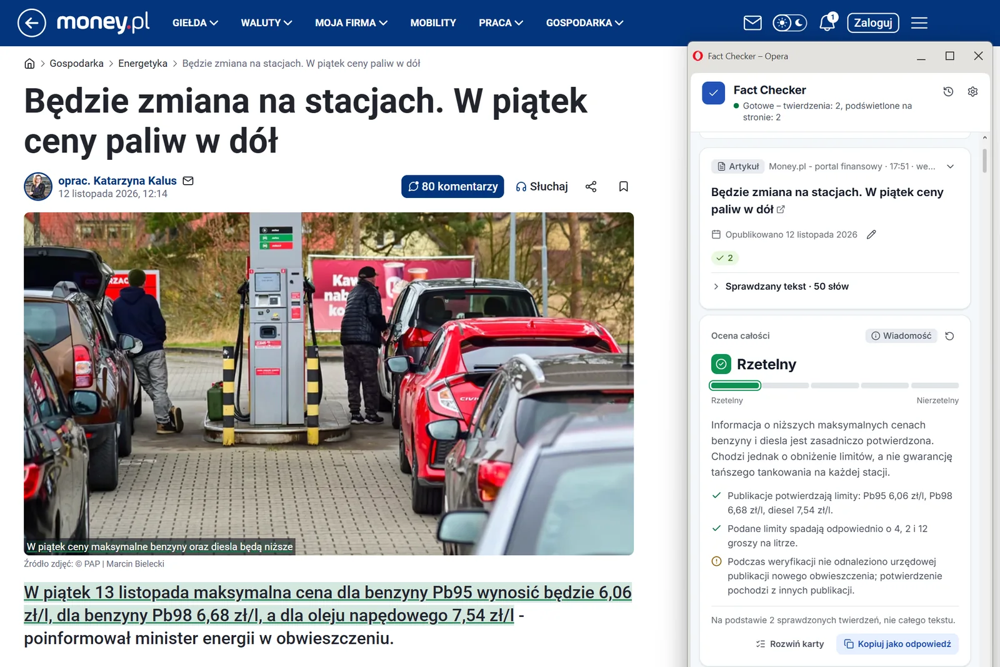

### Debaty i podcasty na żywo

- **Dźwięk karty albo mikrofon**: otwórz film albo transmisję, kliknij **Start** – werdykty pojawiają się w trakcie rozmowy.
- ✓ **Ikonka w odtwarzaczu YouTube** (opcja): jedno kliknięcie ikonki obok przycisku napisów od razu włącza słuchanie tego
  filmu – bez Start i bez wybierania karty. Dźwięk idzie prosto z filmu (film gra normalnie, karta nie jest wyciszana);
  ponowne kliknięcie zatrzymuje. Domyślnie wyłączona; przeglądarka pyta o dostęp tylko do youtube.com.
- Mowę zamienia na tekst **lokalny model na Twoim komputerze** (za darmo, bez internetu) – przy pierwszym **Start** wtyczka
  sama zaproponuje odpowiedni i go pobierze – albo OpenAI.
- **Teraz mówi:** wskazujesz, kto mówi; werdykty, chwyty i raport przypisują wypowiedzi tej osobie.
- **Raport:** cała debata jako dokument – rozkład werdyktów, tabela mówców (twierdzenia, prawdziwe, problemy, chwyty),
  wszystkie werdykty ze źródłami; druk / zapis jako PDF albo pobranie jako HTML.

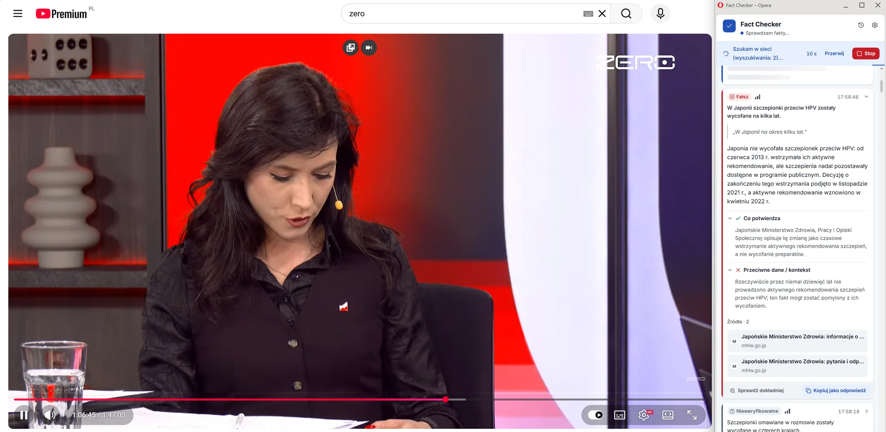

### Sesje, koszty i prywatność

- Wszystko, co sprawdzasz, trafia do bieżącej sesji, z podziałem na źródła; 🕘 Historia z wyszukiwarką, otwieraniem, eksportem
  i usuwaniem. **Kolejka:** kolejne posty możesz wskazywać, zanim skończy się sprawdzanie poprzedniego.
- **Licznik kosztów** sesji i dnia, opcjonalny **dzienny limit wydatków** i trzy tryby: *Oszczędny* / *Normalny* / *Dokładny*.
- **Ukrywaj osoby:** zamazuje zdjęcia profilowe i nazwy autorów na zrzutach i nie wysyła autora posta.
- **Eksport dokładniejszych sprawdzeń** do JSON (werdykt przed i po, Twoja uwaga, kontekst) – do poprawiania promptów.
  Filtr **Tylko problemy**, eksport do Markdown.
- Bez statystyk i bez własnego serwera; klucze API mogą znikać po zamknięciu przeglądarki – zobacz [PRIVACY.md](PRIVACY.md).

### Kto sprawdza fakty

| Dostawca | Czego potrzebujesz | Wyszukiwanie w sieci | Obrazki |
|---|---|---|---|
| **Plan ChatGPT** | logowanie kontem ChatGPT Plus/Pro | zależy od modelu i konta | tak |
| **OpenAI** | klucz API (płatne za użycie) | tak | tak |
| **Google Gemini** | klucz API – jest darmowy limit | tak (Google Search; darmowa pula miesięczna) | tak |
| **Anthropic Claude** | klucz API (płatne za użycie) | tak (trzeba je włączyć w konsoli Anthropic) | tak |
| **OpenRouter** | jeden klucz, wiele modeli (Claude, Gemini, GPT, darmowe) | tak | zależy od modelu |

Anthropic nie pozwala używać logowania Claude Free/Pro/Max w aplikacjach innych firm, więc Claude działa tylko z kluczem API.
Z planem ChatGPT wtyczka nic dodatkowo nie kosztuje: sprawdzanie faktów korzysta z planu, a transkrypcja działa lokalnie
(program OpenAI jest w wersji preview; zużycie wlicza się do limitów planu, zobacz
[ChatGPT → Settings → Usage](https://chatgpt.com/settings/usage)).

### Instalacja

Pobierz paczkę dla swojej przeglądarki z **[najnowszego wydania](https://github.com/dawidadach/fact-checker/releases/latest)**
i rozpakuj.

| | Chrome | Edge | Opera |
|---|---|---|---|
| Paczka | `fact-checker-chrome.zip` | `fact-checker-edge.zip` | `fact-checker-opera.zip` |
| Strona wtyczek | `chrome://extensions` | `edge://extensions` | `opera://extensions` |
| Tryb dewelopera | prawy górny róg | lewy panel, na dole | prawy górny róg |
| Panel | panel boczny Chrome | panel boczny Edge | pasek boczny Opery albo małe okno obok przeglądarki |
| Wbudowane rozpoznawanie mowy | tak (mikrofon) | tak (mikrofon) | nie – użyj lokalnego modelu albo OpenAI |

Potem **Załaduj rozpakowane** → rozpakowany folder i przypnij ikonę (ikona puzzla → pinezka / oko). Wymaga przeglądarki
opartej na Chromium w wersji 116 lub nowszej. Katalog główny repozytorium to wersja dla Chrome, więc `git clone` też można
załadować bezpośrednio w Chrome albo Edge. Szczegółowa instrukcja: **[INSTRUKCJA.md](INSTRUKCJA.md)**.

**Aktualizacja bez utraty ustawień:** podmień pliki w tym samym folderze i kliknij **↻ Przeładuj** przy wtyczce. **Nie**
klikaj **Usuń** – to kasuje dane wtyczki (logowanie, klucze, modele, historię). Wtyczka ma stały identyfikator
(`key` w `manifest.json`), więc wszystko zostaje po aktualizacji.

### Użycie

1. **Post, artykuł albo obrazek:** otwórz stronę, kliknij ikonę Fact Checkera i użyj 👆 Wskaż post, 📄 Artykuł,
   ✂ Zaznaczenie albo 🔲 Wycinek – albo prawy przycisk → Fact Checker. Dłuższe teksty i wszystkie obrazki najpierw pokazują
   podgląd.
2. **Debata albo podcast:** otwórz kartę z filmem, kliknij ikonę Fact Checkera **będąc na tej karcie**, wybierz
   **Dźwięk karty** albo **Mikrofon** i kliknij **Start**.
3. W ⚙ **Ustawieniach** na górze są języki, niżej dostawca i model, tryb sprawdzania, dzienny limit i ochrona przed
   oszustwami, a w grupie **Słuchanie na żywo** – zamiana mowy na tekst, modele lokalne i rytm słuchania.

Interfejs jest po polsku albo po angielsku (według języka przeglądarki, do zmiany w Ustawieniach). Werdykty są pisane w języku
interfejsu, cytaty zostają w oryginale.

### Lokalne modele mowy (tylko do słuchania)

Artykuły, posty i obrazki sprawdzisz bez modelu mowy. Przy pierwszym **Start** wtyczka sama zaproponuje model pasujący do
języka i komputera i pobierze go z paskiem postępu (albo pozwoli użyć OpenAI lub rozpoznawania wbudowanego w przeglądarkę).
Potem działa bez internetu i nic nie wychodzi z komputera.

| Język | Poziom | Model | Pobranie (GPU / CPU) | Wynik testu* |
|---|---|---|---|---|
| Polski | Najlepszy | Whisper Large v3 Turbo | 1,6 GB / 1,1 GB | 21,6% błędnych słów; na żywo potrzebuje karty graficznej |
| Polski | Średni | Whisper Small | 410 MB / 249 MB | 52,7% błędnych słów, ok. 1,5 s na 1 s nagrania na CPU |
| Polski | Lekki | Whisper Base | 165 MB / 77 MB | słaby po polsku |
| English | Najlepszy | Distil-Whisper Large v3.5 | 1,6 GB / 1,0 GB | 0% błędów; na żywo potrzebuje karty graficznej |
| English | Średni | Whisper Small.en | 410 MB / 249 MB | 0% błędów |
| English | Lekki | Moonshine Base | 113 MB / 63 MB | 0% błędów, 1,4 s na 11 s nagrania |

<sub>* Test w Chromium bez karty graficznej (wersje CPU, kwantyzacja q8). Polski: 45 s czytanych zdań z bardzo cichym nagraniem
(FLEURS), angielski: 11-sekundowy fragment przemówienia. Na karcie graficznej modele działają szybciej i w lepszej precyzji (fp16).</sub>

### Prywatność

- Tekst i obrazki ze stron trafiają do wybranego dostawcy modelu tylko po ich wskazaniu (albo kliknięciu ikonki przy poście); przy wskazywaniu najpierw widzisz podgląd.
- Opcjonalna ikonka przy postach daje wtyczce dostęp do facebook.com i/lub x.com (każdy włączany osobno) tylko po to, żeby pokazywać ikonkę po najechaniu na post; post jest czytany dopiero po kliknięciu.
- Opcjonalna ikonka w odtwarzaczu YouTube daje wtyczce dostęp do youtube.com tylko po to, żeby pokazać ikonkę w odtwarzaczu; film jest słuchany dopiero po jej kliknięciu.
- Opcjonalna ikonka przy artykułach daje wtyczce dostęp do serwisów informacyjnych, które zostawisz zaznaczone (albo – przy „Wszędzie” – do wszystkich stron), tylko po to, żeby rozpoznać artykuł po budowie strony i pokazać ikonkę po najechaniu na tytuł; artykuł jest czytany dopiero po kliknięciu.
- Sprawdzanie oszustw i poziomu źródeł działa w przeglądarce; Lista CERT Polska jest pobierana w całości, więc nikt nie wie,
  co sprawdzasz.
- Przy lokalnym modelu mowy dźwięk zostaje na Twoim komputerze; do dostawcy modelu trafia tylko tekst.
- Klucze i tokeny logowania zostają w tej przeglądarce. Szczegóły: [PRIVACY.md](PRIVACY.md).

### Budowanie i testy

```bash
npm test         # testy jednostkowe (node --test)
npm run build    # dist/fact-checker-chrome.zip, dist/fact-checker-edge.zip, dist/fact-checker-opera.zip
```

### Zasoby zewnętrzne

- Czcionka **Inter** (rsms/inter) – SIL Open Font License 1.1, `fonts/Inter-OFL.txt`.
- Ikony **Lucide** – licencja ISC, `lib/LUCIDE-LICENSE.txt`.
- **Mozilla Readability** – licencja Apache 2.0 (`lib/vendor/`).

### Autorzy

Fact Checkera rozwijają [Dawid Adach](https://github.com/dawidadach) i [Wojciech Kałużny](https://github.com/wojciechkaluzny-ctrl).

### Stan projektu

Sprawdzanie postów, obrazków i odpowiedzi było używane na prawdziwych postach z Facebooka i X oraz artykułach z planem ChatGPT,
a funkcje na żywo – na prawdziwych debatach na YouTube po polsku i po angielsku (zobacz zrzuty ekranu). Wszystkie funkcje mają
testy jednostkowe i testy całościowe w Chromium z podstawionymi serwerami dostawców; Gemini, Claude i OpenRouter były na razie
testowane tylko na podstawionych serwerach. Jeśli coś nie działa, kliknij prawym przyciskiem w panelu → **Zbadaj**, sprawdź
zakładkę Console i zgłoś problem w Issues.
